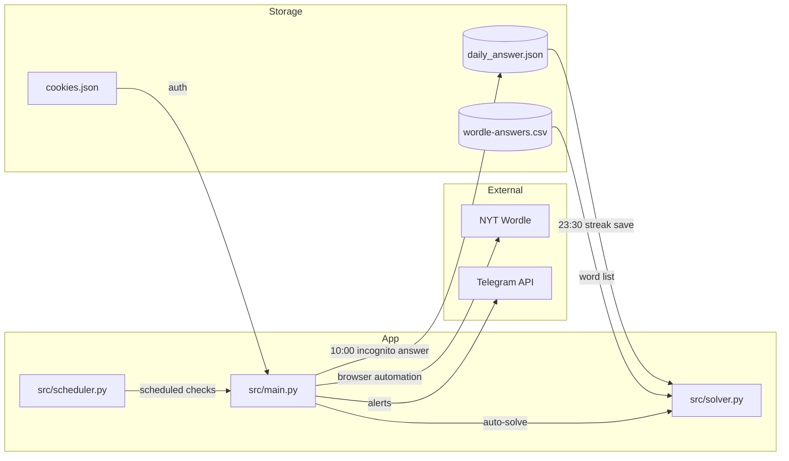

# Wordle Alarm

[](https://github.com/momonala/wordle-alarm/actions/workflows/ci.yml)
[](https://codecov.io/gh/momonala/wordle-alarm)

Automated NYT Wordle checker that sends Telegram alerts if you haven't played, and auto-solves the puzzle late at night.

## Prerequisites

- Python 3.12
- uv (Python package manager)
- Chromium (installed via Playwright)
- Telegram Bot token and chat ID
- NYT Wordle cookies (for authenticated session)

## Installation

1. Clone the repository:
   ```bash
   git clone https://github.com/momonala/wordle-alarm.git
   cd wordle-alarm
   ```

2. Install dependencies:
   ```bash
   curl -LsSf https://astral.sh/uv/install.sh | sh
   uv sync
   ```

3. Install Playwright browsers:
   ```bash
   uv run playwright install chromium
   uv run playwright install-deps
   ```

4. Copy `.env.example` to `.env` and fill in your credentials:
   ```
   TELEGRAM_TOKEN=your-bot-token
   TELEGRAM_CHAT_ID=your-chat-id
   ```

5. Export NYT cookies to `secrets/cookies.json`:
   - Log into nytimes.com/games/wordle
   - Use a browser extension to export cookies as JSON
   - Save to `secrets/cookies.json`

   Required cookie format:
   ```json
   [
     {
       "name": "cookie-name",
       "value": "cookie-value",
       "domain": ".nytimes.com",
       "path": "/",
       "sameSite": "Lax",
       "secure": true,
       "httpOnly": false,
       "expirationDate": 1234567890
     }
   ]
   ```

## Running

**Manual check:**
```bash
uv run main
```

**Scheduled daemon:**
```bash
uv run src/scheduler.py
```

Default schedule: 10:00, 17:00, 20:00, 22:30, 23:30 daily

### Streak protection

The 10:00 run also plays a throwaway incognito game, which learns the day's answer either
way it ends: a win finishes on it, and a loss has NYT reveal it in a toast. That answer is
cached in `cache/daily_answer.json` under today's date.

If the puzzle still has not been played by 23:30, the auto-solve fires against the real
account and plays the cached answer straight away — winning in one guess rather than
re-deriving it and risking the same loss twice. A missing or stale cache entry simply falls
back to solving from scratch.

## Project Structure

```
wordle-alarm/
├── src/
│   ├── main.py               # Entry point, Wordle status checker
│   ├── solver.py             # Auto-solver algorithm and game state
│   ├── scheduler.py          # Cron-like scheduler daemon
│   ├── daily_cache.py        # Caches the day's answer and played flag
│   ├── auth.py               # Cookie loading/formatting for Playwright
│   ├── page_utils.py         # Cookie-banner dismissal and other page helpers
│   ├── config.py             # Non-secret config from pyproject.toml [tool.config]
│   └── env.py                # Loads Telegram credentials from .env
├── .env.example              # Stub credentials used in CI; copy to .env (gitignored)
├── wordle-answers.csv        # Word list with frequency scores
├── pyproject.toml            # Project dependencies
├── secrets/
│   └── cookies.json          # NYT session cookies (gitignored)
├── install/
│   ├── install.sh            # Linux setup script
│   └── projects_wordle-alarm.service  # systemd unit file
├── cache/                    # Today's answer (gitignored)
└── tmp/                      # Debug dumps (HTML pages)
```

## Architecture



## Key Concepts

| Concept | Description |
|---------|-------------|
| `GameMode.PLAY` | Game not started today |
| `GameMode.CONTINUE` | Game started but incomplete |
| `WordleState` | Tracks all guesses and tile states |
| `Tile` | Single letter with position and state (`correct`, `present`, `absent`) |
| Late night | After 22:00 - triggers auto-solve |
| `frequency` | Word commonality score in CSV, higher = more likely answer |

## Data Models

```
WordleState
├── guesses: dict[GuessNumber, list[Tile]]
│   └── GuessNumber: FIRST through SIXTH
└── Tile
    ├── pos: int (1-5)
    ├── letter: str
    └── state: str (correct|present|absent)
```

## Solver Algorithm

1. Start with "trace" as first guess
2. Parse tile states from page HTML
3. Filter word list by:
   - Correct letters in correct positions
   - Present letters not in wrong positions
   - Absent letters excluded (unless present elsewhere)
4. Select highest-frequency remaining word
5. Repeat until solved or 6 guesses exhausted

## Storage

| File | Purpose |
|------|---------|
| `secrets/cookies.json` | NYT authentication cookies |
| `wordle-answers.csv` | 14,856 five-letter words with frequency scores |
| `tmp/wordle_page_dump.html` | Debug: last page HTML dump |

Telegram credentials come from `.env`; NYT cookies from `secrets/cookies.json`.
